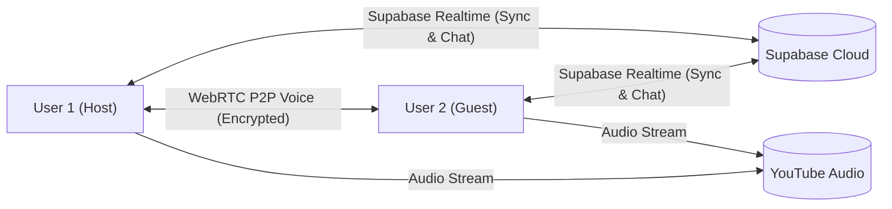

# Welcome to the JoinMe Wiki 🎵

**JoinMe** is an open-source, cross-platform mobile application built with **Flutter and Dart** that allows two listeners to listen to the exact same music simultaneously in real-time, regardless of physical distance.

Whether you and your partner or friend are across the city or across the globe, JoinMe keeps you connected through synchronized YouTube music streaming, low-latency playback controls, collaborative queueing, live reaction bursts, and real-time voice chat.

---

## 🧭 Wiki Table of Contents

- **[System Architecture](Architecture)**: Detailed breakdown of the app architecture, state management, and real-time synchronization algorithm.
- **[Audio Streaming Pipeline](Audio-Streaming)**: How YouTube audio streams are extracted and played with background audio support.
- **[Supabase Realtime Setup](Supabase-Realtime-Setup)**: Step-by-step tutorial on creating and configuring your Supabase project.
- **[WebRTC Voice Chat](WebRTC-Voice-Chat)**: Deep dive into peer-to-peer encrypted voice calls and signaling.
- **[iOS & Android Deployment](iOS-and-Android-Deployment)**: Complete build instructions for Xcode (macOS/iOS) and Android Studio/Gradle.

---

## ⚡ Key Highlights

- **Framework:** Flutter 3.x+ (Dart 3.x+)
- **Platforms:** iOS (Xcode 15+ / iOS 13.0+) & Android (API 23+)
- **Audio Engine:** `just_audio` + `audio_video_progress_bar`
- **Music Source:** `youtube_explode_dart` (Direct high-bitrate audio extraction)
- **Real-Time Sync & Presence:** `supabase_flutter` Realtime Broadcast Channels
- **Voice Calling:** `flutter_webrtc` (DTLS-SRTP encrypted peer-to-peer audio)
