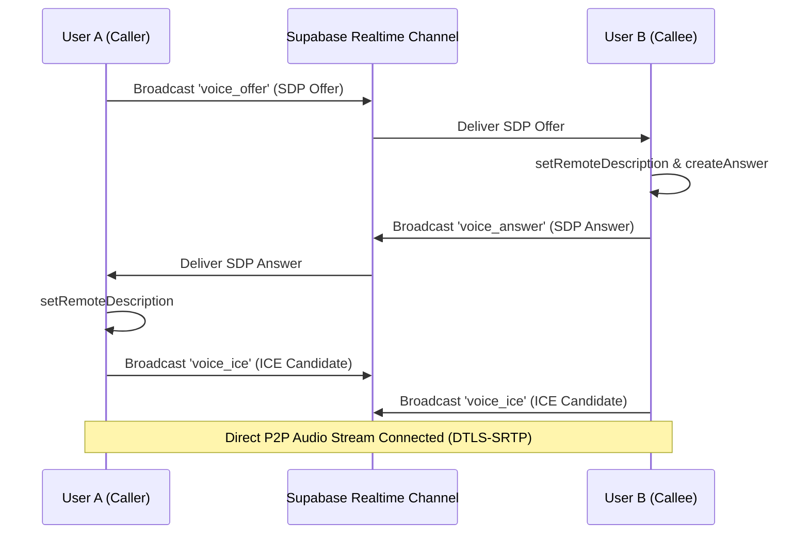

# WebRTC Voice Chat Architecture

JoinMe includes real-time, peer-to-peer voice calling while music is playing, enabling natural conversation without third-party meeting apps.

---

## 1. How WebRTC Signaling Works

WebRTC requires an out-of-band signaling mechanism for two devices to exchange connection metadata (Session Description Protocol / SDP) and network paths (Interactive Connectivity Establishment / ICE candidates).

JoinMe utilizes the existing **Supabase Realtime Channel** as the signaling plane:

---

## 2. STUN & TURN Infrastructure

JoinMe comes preconfigured with Google's public, low-latency STUN servers:
- `stun:stun.l.google.com:19302`
- `stun:stun1.l.google.com:19302`

STUN resolves NAT (Network Address Translation) and firewall mappings so two mobile devices can communicate directly.

---

## 3. Audio Optimization for Music + Speech

When voice chat is active alongside music:
- Echo cancellation (`echoCancellation: true`)
- Noise suppression (`noiseSuppression: true`)
- Auto gain control (`autoGainControl: true`)

These native audio session properties ensure that speaker audio from the chimes/music does not loop back into the microphone.
